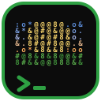

  

<h1 align="center">ASCII Video Player</h1>

  
  
  
  

Player de vídeo para o terminal. Cada quadro vira texto em caracteres coloridos, ajustado ao tamanho da janela, com o áudio tocando junto. Roda no Windows, no Linux, no macOS e também no navegador, sem o vídeo sair da sua máquina.

  <b><a href="https://guavovic.github.io/ascii-video-player/">Experimente no navegador</a></b>
  &nbsp;•&nbsp;
  <a href="https://github.com/guavovic/ascii-video-player/releases/latest">Baixar</a>
  &nbsp;•&nbsp;
  <a href="https://www.nuget.org/packages/ascii-video-player">NuGet</a>
  &nbsp;•&nbsp;
  <a href="docs/decisions">Decisões de arquitetura</a>

**O player**, trocando entre ascii, pontilhado e contornos:

Vídeos dos GIFs: <a href="https://peach.blender.org">Big Buck Bunny</a> (licença <a href="https://creativecommons.org/licenses/by/3.0/">CC BY 3.0</a>) e <a href="https://studio.blender.org/films/spring/">Spring</a> (licença <a href="https://creativecommons.org/licenses/by/4.0/">CC BY 4.0</a>), © Blender Foundation.

## Destaques

- **Cinco estilos de imagem:** letras, meio bloco, braille, pontilhado e contornos, com cor ou sem cor.
- **Áudio como relógio:** o vídeo segue o som, e um terminal lento pula quadros em vez de atrasar.
- **Qualquer fonte:** arquivo, link, YouTube (com o yt-dlp) e câmera ao vivo, com legendas `.srt`.
- **No navegador:** o mesmo núcleo em C# compilado para WebAssembly, desenhado pela placa de vídeo.
- **Rápido:** a conversão de um quadro colorido inteiro leva menos de 1 ms, sem alocar memória, e binário nativo com Native AOT.

## Como foi feito

A primeira versão era um arquivo só, presa ao Windows, com o caminho do vídeo fixo no código e o áudio quebrado. A segunda foi reconstruída em etapas, cada uma com a decisão registrada num ADR.

<b>Segunda versão:</b> a reconstrução

- **Partes separadas:** leitura do vídeo, conversão para ASCII, desenho no terminal e áudio ficam em pastas próprias, e só a leitura do vídeo e o áudio ficam atrás de interfaces.
- **Linha de comando:** o vídeo é passado como argumento, com opções de largura, FPS, paleta de caracteres, sem áudio e sem cor, e mensagens de erro em português.
- **Desenho no terminal:** a imagem acompanha o tamanho da janela, respeita a proporção do caractere e sai colorida. Cada quadro é montado num buffer e escrito de uma vez, numa tela separada que some ao terminar.
- **Áudio como relógio:** o vídeo segue a posição do que já saiu na caixa de som, como fazem os players de vídeo, e um terminal lento pula quadros em vez de ficar para trás.
- **Qualquer sistema:** o vídeo e o áudio são decodificados pelo FFmpeg, e o som sai pelo OpenAL Soft, que funciona nos três sistemas.
- **Testes e medição:** testes unitários com dublês feitos à mão, testes de integração com o FFmpeg de verdade nos três sistemas e benchmark da conversão (um quadro colorido inteiro em menos de 1 ms, sem alocar memória).
- **Distribuição:** binário nativo compilado com Native AOT para cada sistema, publicado automaticamente a cada versão.

<b>Terceira versão:</b> um player de verdade

- **Estilos de imagem:** além das letras, meio bloco (o dobro de resolução vertical), braille, pontilhado e contornos. A cor vai no brilho máximo e o brilho fica por conta da densidade do caractere, para a imagem não ficar apagada.
- **Controles:** pausar, avançar e voltar, barra de progresso, começar de um ponto, repetir e legendas `.srt` por cima do vídeo.
- **Outras fontes:** links de vídeo (e de sites como o YouTube, com o yt-dlp) e a câmera ao vivo, aberta pelo nome.
- **Exportar:** o vídeo convertido vira uma página HTML que toca sozinha, num arquivo só.
- **No navegador:** o mesmo núcleo em C# compilado para WebAssembly, numa página com cara de Prompt de Comando em que o vídeo nunca sai do computador. Toca arquivos e a câmera, e a placa de vídeo desenha (WebGL), o que aguenta até 500 colunas sem travar.
- **Menos dados por quadro:** a cor parecida com a anterior é reaproveitada, o que corta cerca de 40% dos bytes enviados ao terminal sem diferença visível. O desempenho ao vivo aparece no título da janela.

## Tecnologias

- **Aplicação:** .NET 10, System.CommandLine, sequências ANSI para cor e controle do terminal.
- **Mídia:** FFmpeg para o vídeo e o áudio, OpenAL Soft (Silk.NET) para tocar o som e yt-dlp, opcional, para links de sites de vídeo.
- **Navegador:** .NET para WebAssembly, WebGL e o próprio `<video>` do navegador.
- **Testes:** xUnit v3, Shouldly e BenchmarkDotNet.
- **Entrega:** GitHub Actions com build e testes no Windows, no Linux e no macOS, Native AOT nas releases e GitHub Pages para o player no navegador.

---

Licença [MIT](LICENSE) · Feito por [Gustavo Victor](https://github.com/guavovic)
